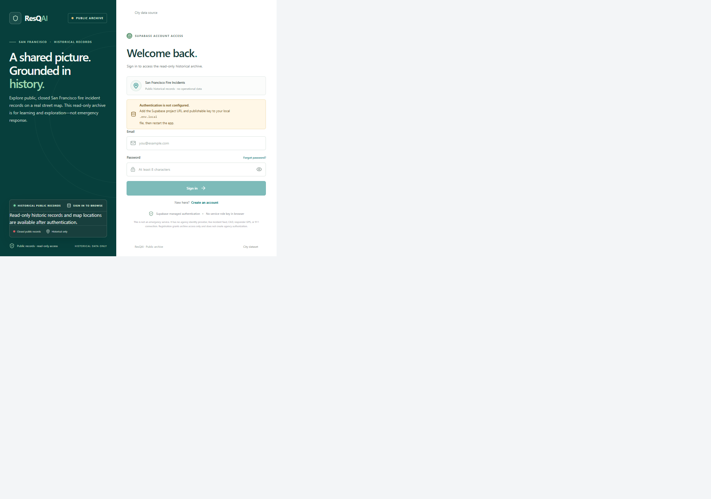
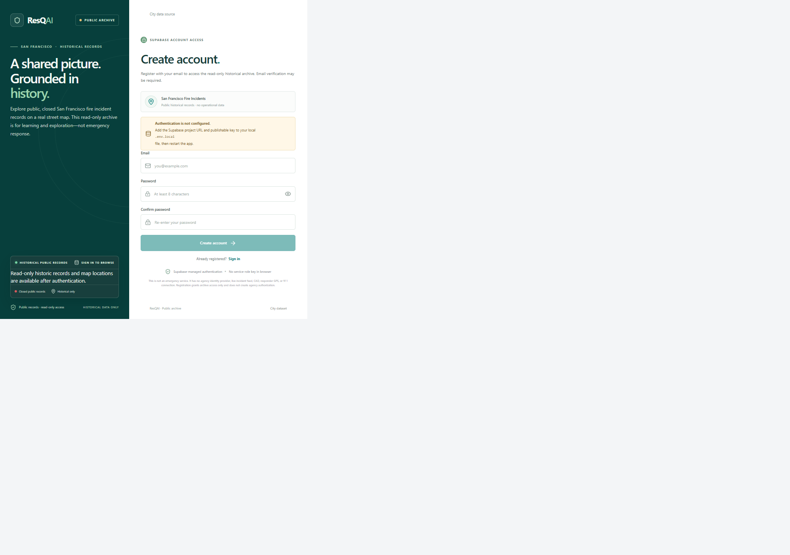
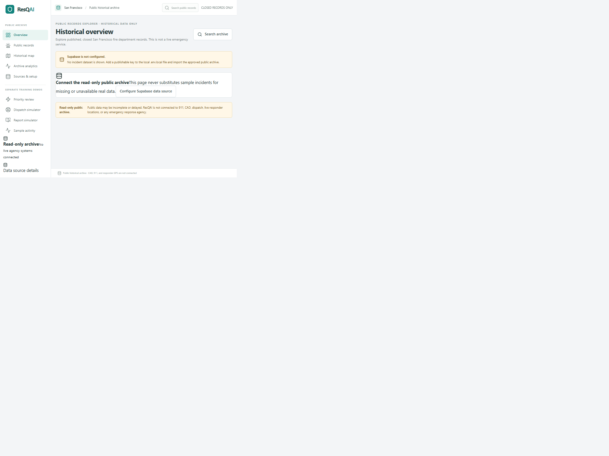
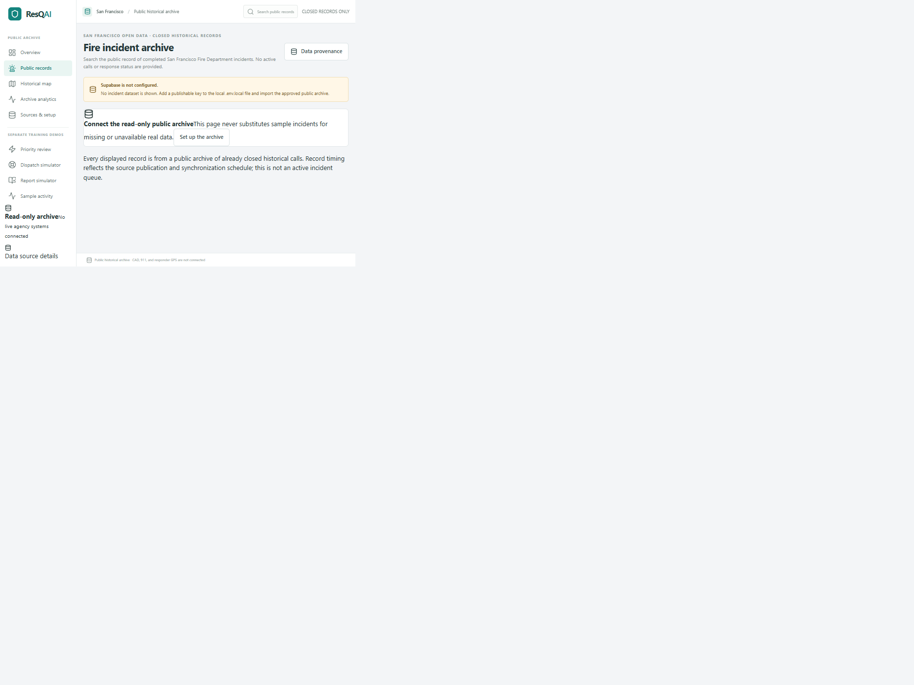
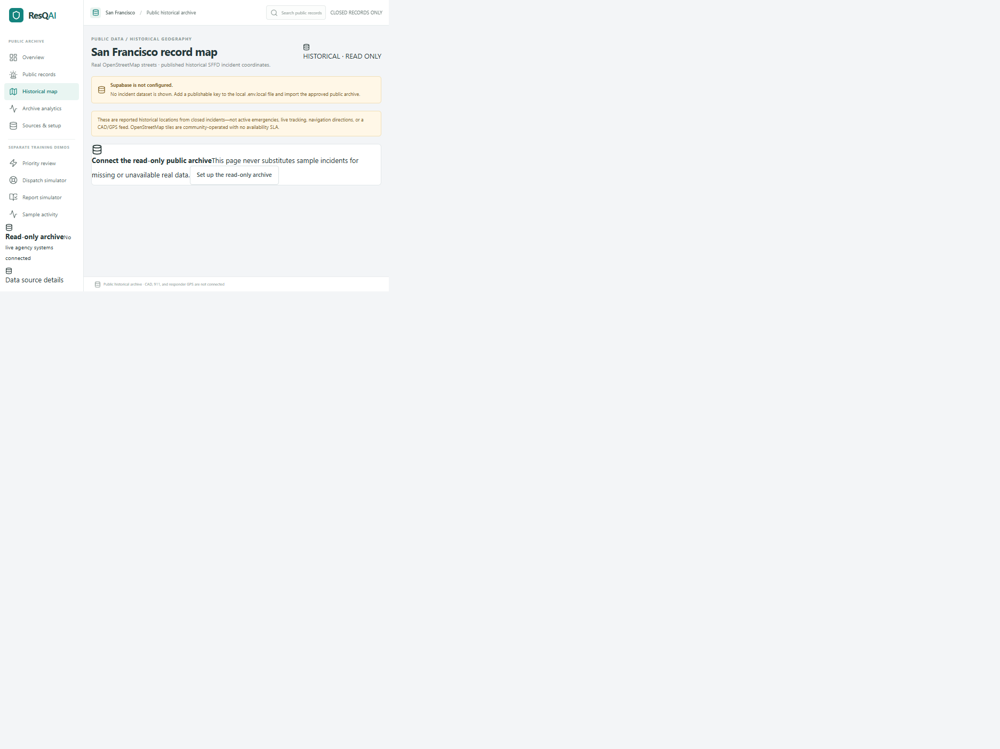
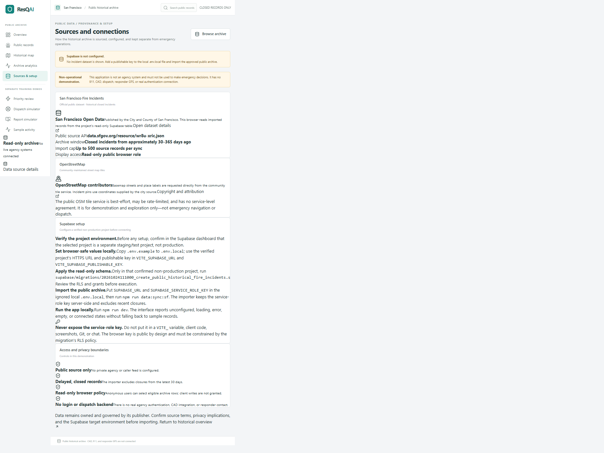

<div align="center">

# ◈ RESQAI
### **A shared picture. Grounded in history.**

**PUBLIC SAN FRANCISCO FIRE RECORDS · READ-ONLY ARCHIVE · NON-OPERATIONAL DEMONSTRATION**

<br />


<br />

> ### ◈ A carefully bounded public-data explorer
> Explore closed historical San Francisco Fire Department records on a real OpenStreetMap basemap. Separate training screens demonstrate interface concepts with fictional local data; they are not connected to emergency services.

**No live calls · No dispatch · No responder tracking · No agency authentication**

</div>

<br />

## ◇ Project overview

ResQAI is a responsive React application for browsing a limited archive of publicly released San Francisco fire incident records. Visitors sign in or create an account through Supabase email/password authentication before opening the archive. A Node.js import script fetches eligible records from the [San Francisco Open Data dataset](https://data.sfgov.org/d/wr8u-xric) and writes them to a Supabase table. The web client reads that table with the authenticated user's session and a browser-safe publishable key.

The app intentionally does **not** present historic public records as active emergencies. Imports are limited to reported closed incidents from roughly 30–365 days ago, subject to the source's availability and the import cap. The browser does not silently substitute fictional incidents when configuration or data is unavailable.

> [!CAUTION]
> **This is not an emergency-response product.** It is not connected to 911, CAD, agency identity systems, dispatch, radio, responder GPS, or live incident feeds. Never use it for emergency decisions, operational navigation, or real incident reporting.

## ◇ Screenshots & design reference

The visual direction is based on the [ResQAI Figma design](https://www.figma.com/design/RzhtVdD740gAaXoiXnRpT3/Untitled?node-id=3-37442). The screenshots below were captured from the running app at a desktop viewport. **Supabase is not configured in these captures**, so sign-in and registration are visibly disabled until local configuration is added. The basemap requires network access to OpenStreetMap's community tile service.

<details>
<summary>Sign in</summary>



</details>

<details>
<summary>Registration</summary>



</details>

<details>
<summary>Historical overview</summary>



</details>

<details>
<summary>Public records</summary>



</details>

<details>
<summary>Historical map</summary>



</details>

<details>
<summary>Sources and setup</summary>



</details>

| Screen | Preview |
| --- | --- |
| Sign in | [`/login`](http://localhost:5173/login) |
| Create an account | [`/register`](http://localhost:5173/register) |
| Historical overview | [`/overview`](http://localhost:5173/overview) |
| Public fire records | [`/incidents`](http://localhost:5173/incidents) |
| Record detail | Open any record from the archive |
| Historical map | [`/map`](http://localhost:5173/map) |
| Archive analytics | [`/analytics`](http://localhost:5173/analytics) |
| Data sources and setup | [`/sources`](http://localhost:5173/sources) |
| Training simulator | [`/mobile`](http://localhost:5173/mobile) |

The local preview links work after starting Vite with `npm run dev`. Configuration and imported records are required to see archive content.

## ◇ Features

| Area | What is included |
| --- | --- |
| **Public archive** | Read-only browsing, search, filters, pagination, source-linked detail pages, and honest loading/error/unconfigured/empty states |
| **Real map** | Leaflet with OpenStreetMap tiles, visible attribution, and markers from source-published coordinates |
| **Descriptive analytics** | Counts and charts derived from the records loaded in the current archive result—no invented response-time or readiness metrics |
| **Data pipeline** | Bounded Socrata API import, record/date/coordinate validation, chunked Supabase upserts, and a 30-day closure delay |
| **Access controls** | Supabase email/password auth, protected application routes, persistent browser sessions, self-owned profile rows with database-generated public IDs, row-level security, and server-only import credentials |
| **Optional historical AI** | User-initiated Gemini descriptions for aggregate historical trends and one closed public record; server-side key, rate-limited Edge Function, no live or operational analysis |
| **Responsive interface** | Desktop, tablet, and mobile layouts; keyboard-friendly forms and controls; reduced-motion and print styles |
| **No success-shaped fallback** | The UI shows setup, loading, empty, and error states instead of swapping in sample records when the data source fails |

## ◇ Application routes

| Route | Purpose |
| --- | --- |
| `/login` | Supabase email/password sign-in and password recovery |
| `/register` | Public self-registration through Supabase Auth; email confirmation follows project settings |
| `/account` | Authenticated profile with a permanent database-generated public User ID and editable display name |
| `/overview` | Historical archive summary and recent closed records |
| `/incidents` | Searchable, filterable public incident archive |
| `/incidents/:id` | Detail view for a record included in the current archive result |
| `/map` | Map of source-published historical coordinates |
| `/analytics` | Descriptive statistics for the loaded archive records |
| `/analytics` AI trends panel | Optional Gemini-generated description of aggregate monthly, neighborhood, and situation counts |
| `/incidents/:id` AI summary panel | Optional Gemini summary of the selected closed historical record's date and source classifications |
| `/sources` | Data provenance, setup instructions, and safety boundaries |
| `/training/report`, `/training/incidents/:id` | Fictional local report-intake exercise |
| `/training/review`, `/training/dispatch` | Fictional manual-review and dispatch-interface exercises; no AI/model is connected |
| `/training/settings`, `/training/team`, `/training/activity` | Example-only controls, profiles, and sample activity |
| `/mobile`, `/mobile/incidents/:id`, `/mobile/review/:id` | Separate mobile training simulator screens |

Legacy `/review`, `/dispatch`, `/settings`, `/team`, and `/activity` routes redirect to their clearly labeled training versions.

## ◇ Architecture

```text
Public San Francisco Open Data
           │
           │ bounded server-side import (manual)
           ▼
┌───────────────────────────────┐
│ Supabase · sf_fire_incidents  │
│ RLS: delayed rows, read-only  │
└───────────────┬───────────────┘
                │ authenticated browser session · SELECT only
                ▼
┌───────────────────────────────┐       OpenStreetMap tile service
│ React + TypeScript archive UI │ ────► attributed Leaflet basemap
└───────────────────────────────┘
               │ authenticated session · own profile only
               ▼
┌───────────────────────────────┐
│ Supabase · profiles           │
│ RLS: self select/update name  │
└───────────────────────────────┘

Separate training routes ──► fictional browser-session state only
```

First visit → sign in/register → Supabase Auth session → protected archive routes. Archive records remain read-only; the separate profile table permits each authenticated user to read their own profile and update only their display name. Optional AI calls go from the browser to a JWT-validated Supabase Edge Function, which reads eligible records under the caller's RLS and sends minimized data to Gemini with storage disabled.

| Layer | Responsibility |
| --- | --- |
| `scripts/sync-sf-public-fire-data.mjs` | Fetches a maximum of 500 closed records in the configured age window, validates the source values, then upserts to Supabase with a server-only key |
| `supabase/migrations/` | Creates the archive and profile tables, indexes, RLS policies, signup trigger, and least-privilege grants |
| `supabase/functions/historical-ai-analysis/` | Authenticates the caller, enforces a per-user request limit, reads only delayed closed records, and calls Gemini without exposing its key |
| `src/dataContext.tsx` | Loads at most 500 newest eligible rows and exposes loading, ready, unconfigured, and error states |
| `src/lib/supabase.ts` | Configures the Supabase browser client and rejects invalid URLs or obvious non-public keys |
| `src/components/HistoryMap.tsx` | Renders source coordinates using Leaflet and OpenStreetMap tiles with visible attribution |
| `src/components/PublicFeedStatus.tsx` | Displays connection status without a mock-data fallback |
| `src/pages/` | Public archive pages and separately labeled training experiences |
| `src/state.tsx`, `src/data.ts` | Fictional sample data and in-memory interactions used only by training screens |

## ◇ Tech stack

- **React 18** and **TypeScript 5** — typed, reusable UI components
- **Vite 6** — local development server and production bundler
- **React Router 7** — client-side navigation and deep-linked pages
- **Supabase Auth and JavaScript client** — email/password authentication, read-only archive access, and authenticated Edge Function calls
- **Supabase Edge Functions + Gemini Interactions API** — optional server-side historical descriptions, only after project configuration
- **Leaflet** and **React Leaflet** — interactive map rendering
- **OpenStreetMap** — community basemap tiles, with required attribution
- **Tailwind CSS 3** and project CSS — configured styling pipeline and fine-grained responsive design
- **Lucide React** — interface iconography

## ◇ Requirements

- Node.js **22.9 or newer** (the importer uses Node's `--env-file-if-exists` option)
- npm compatible with the installed Node.js release
- A Supabase project that has been explicitly verified as a **non-production staging/test environment**

The sign-in and registration pages can start without Supabase configuration, but authentication is disabled and protected archive routes cannot be opened until the project URL and publishable key are configured.

## ◇ Installation & configuration

### 1. Install dependencies

```bash
git clone https://github.com/sumanth-bandla/ResQAI.git
cd ResQAI
npm install
```

### 2. Verify the Supabase environment

Before applying SQL or importing data, confirm in the Supabase dashboard that the selected project is a separate staging/test project—not production. The project reference in `.env.example` is a configuration starting point, **not proof that the target is staging**.

### 3. Create a local environment file

Copy `.env.example` to `.env.local` and fill in the values from the verified Supabase project's API settings:

```dotenv
# Browser-safe values; a publishable key or legacy anon JWT only.
VITE_SUPABASE_URL=https://YOUR_PROJECT_REF.supabase.co
VITE_SUPABASE_PUBLISHABLE_KEY=YOUR_PUBLISHABLE_OR_ANON_KEY

# Import-only secrets. Keep these server-side and out of VITE_ variables.
SUPABASE_URL=https://YOUR_PROJECT_REF.supabase.co
SUPABASE_SERVICE_ROLE_KEY=YOUR_SERVICE_ROLE_KEY

# Optional public-data API token.
SF_OPEN_DATA_APP_TOKEN=
```

`.env.local` is ignored by Git. Never paste a service-role key into source code, a `VITE_` variable, an issue, a screenshot, a commit, or chat.

The development server must be restarted after creating or changing `.env.local`, because Vite loads `VITE_` variables at startup. The app deliberately keeps sign-in, registration, and protected routes disabled until both browser-safe Supabase values are present; do not replace this gate with a demo account or a service-role key.

### 4. Configure Supabase Auth

In the verified project's dashboard:

1. Enable the **Email** provider and email/password sign-in. Keep email confirmation enabled; the client does not bypass it.
2. In **Authentication → URL Configuration**, set Site URL to the app origin and add each exact callback/recovery URL to Redirect URLs. For local development on port 5173, allow `http://127.0.0.1:5173/auth/callback`, `http://127.0.0.1:5173/login?recovery=1`, and the corresponding `http://localhost:5173/...` URLs if you use that hostname. Add the equivalent paths for the deployed origin. Do not add broad production wildcards.
3. Public self-registration is enabled by this app. Configure email delivery, password policy, abuse protections, and project rate limits before deployment.

Registration confirmation redirects to `/auth/callback`; password recovery returns to `/login?recovery=1`. Supabase JS processes the supported PKCE/verification callback and the callback page verifies the returned user with Supabase before showing success. Expired, invalid, and already-used links get a recovery state. The app persists sessions through Supabase Auth and does not use a service-role key for authentication.

Sign-up requests are submitted to Supabase Auth, which manages account identities in its protected `auth.users` schema and handles passwords securely. A database trigger creates a separate `profiles` row keyed by the Auth UUID and assigns its unique public User ID; passwords are never copied to the profile table. With email confirmation enabled, users must verify their email before signing in. The post-registration page reports that the request was submitted without claiming account creation or email delivery; resend is explicit, cooldown-limited, and reports whether Supabase accepted the request. Sign-out clears the current browser session locally so a network interruption does not leave this browser authenticated.

#### Email delivery, SMTP, and rate limits

The connected project's dashboard was inspected during this implementation. Its **Authentication → Emails** page offered “Set up custom SMTP” and indicated that the default templates are used, so custom SMTP was not configured at that time. The **Authentication → URL Configuration** page showed Site URL `http://localhost:3000` and no Redirect URLs; those values do not match this app's Vite port 5173 and must be corrected manually before links can return here. No production settings were changed. The rate-limit settings page could not be loaded during inspection, so the project's exact email limits were not verified.

Supabase's built-in email service is intended for low-volume/testing and is subject to restrictive provider limits. An `Email rate limit exceeded` response is Supabase rejecting an email request; this app does not automatically retry signup or resend. The current signup form disables duplicate submissions while a request is in flight, and resend is a separate user action with a visible local cooldown. Repeated signups/resends are not a delivery workaround.

For reliable legitimate delivery, configure a supported custom SMTP provider in **Supabase Dashboard → Authentication → Emails → SMTP Settings**:

1. Set up a transactional-email provider and verify a domain/sender you control.
2. Publish the provider's required SPF and DKIM DNS records (and DMARC where appropriate); wait for provider verification.
3. Enter the provider's SMTP host, port, username, password, and verified sender in Supabase. Keep SMTP credentials in the dashboard/provider, never in this browser app or a `VITE_` variable.
4. Send one controlled test to an address you own, inspect provider delivery/bounce logs, and confirm the ResQAI callback URL is allow-listed.
5. Review **Authentication → Rate Limits** after SMTP is configured. Adjust only to documented provider capacity and legitimate traffic; retain abuse protections and do not disable email confirmation to suppress limits.

Rate-limit recovery in the app applies a conservative five-minute client cooldown after an explicit rate-limit response. Supabase remains authoritative; its server-side limit may require a longer wait. For production, review the provider's actual retry guidance and Supabase's current dashboard limits rather than increasing the client timer to bypass them.

#### Safe auth verification checklist

The repository does not currently include a test-runner script. During implementation, registration success, duplicate/neutral signup responses, resend acceptance/cooldown, rate-limit handling, and callback success were exercised with browser-intercepted mock Auth responses; these tests did not create accounts or send email. Invalid/weak form validation and expired-link recovery were also checked in the browser. A real sign-up, delivery, and sign-in should only be tested after the URL allow-list and email sender are configured, using one mailbox you control. Avoid repeated real signup/resend attempts, and do not use `example.invalid` in a live form as a “test.”

The user-facing copy intentionally distinguishes “Supabase accepted the request” from actual email delivery. Only the Supabase dashboard/provider delivery logs can confirm delivery.

#### Optional historical AI (Gemini)

AI analysis is opt-in and limited to delayed, closed public archive data. It is not a prediction or decision system and must not be used for live emergencies, triage, dispatch, responder safety, or navigation. The trends panel sends only server-calculated counts to Gemini; the individual summary sends one record's date, neighborhood, and reported classifications. Addresses, coordinates, caller details, account data, and public record identifiers are not sent to Gemini. Calls use `store: false`; availability and retention are still governed by Google AI service terms.

To enable the feature after reviewing the provider's terms and data policy:

1. Apply `supabase/migrations/20261024200500_add_historical_ai_rate_limit.sql` to the verified Supabase project after the profile and archive migrations. This creates a private rate-limit table and permits quota consumption only by `service_role`.
2. Deploy `supabase/functions/historical-ai-analysis/` using the Supabase CLI while linked to the verified project: `supabase functions deploy historical-ai-analysis`. Keep JWT verification enabled; the function validates the caller and checks the database-backed quota.
3. Create a Gemini API key in Google AI Studio, then store it only as a Supabase Edge Function secret: `supabase secrets set GEMINI_API_KEY=...`. Run that command in a secure local terminal; do not paste the key into chat, source code, `.env.local`, a `VITE_` variable, or Git.
4. Confirm the Edge Function has the project-provided `SUPABASE_URL`, `SUPABASE_ANON_KEY`, and `SUPABASE_SERVICE_ROLE_KEY` secrets available. The service key is used only by the function for a restricted rate-limit RPC; archive reads use the authenticated user's JWT and existing RLS.
5. Check Gemini billing/quota and use the UI's explicit **Generate** action. Trend prompts contain aggregate month/neighborhood/situation counts only; individual summaries contain date and source classifications without record IDs, addresses, or coordinates. Requests are limited to five per user per minute. Missing configuration, provider errors, and rate limits are shown as errors, not fake success.

The feature currently uses Google's Interactions API with `store: false`; Gemini output is untrusted text and is displayed as plain text. The local browser tests do not call Gemini. No AI provider key is configured or tested.

### 5. Apply the migrations in the verified staging project

Review and run [`supabase/migrations/20261024111000_create_public_historical_fire_incidents.sql`](./supabase/migrations/20261024111000_create_public_historical_fire_incidents.sql), [`supabase/migrations/20261024193000_create_user_profiles.sql`](./supabase/migrations/20261024193000_create_user_profiles.sql), and (if enabling AI) [`supabase/migrations/20261024200500_add_historical_ai_rate_limit.sql`](./supabase/migrations/20261024200500_add_historical_ai_rate_limit.sql) in the **confirmed non-production project only**. The archive migration grants authenticated browser users `SELECT` only and limits row visibility to incidents closed more than 30 days ago. The profile migration creates `public.profiles`, generates immutable `RSQ-XXXXXXXX` public IDs inside a database trigger, backfills existing Auth accounts, and grants authenticated users access only to their own profile and permission to update only `full_name`. New registrations need a valid `full_name` Auth metadata value for the profile trigger. The optional AI migration creates a private per-user request-limit table and an RPC callable only by the trusted Edge Function role.

The migration must not be applied to production without a separate, explicitly approved review. SQL execution changes the target database; verify the project selector before running it.

### 6. Import historical public records

```bash
npm run data:sync:sf
```

The importer:

- requests San Francisco records closed between approximately 30 and 365 days ago;
- caps each run at 500 source records and upserts in batches;
- rejects invalid timestamps, missing required fields, and coordinates outside the San Francisco bounds;
- never exposes the service-role credential to the browser;
- exits with an error if configuration, the source response, or a Supabase write fails.

This command writes to the configured Supabase database. Confirm the target before running it. It is a manual import; no automatic or continuous sync is configured.

### 7. Start and build the application

```bash
npm run dev
npm run build
npm run preview
```

| Command | Purpose |
| --- | --- |
| `npm run dev` | Start the local Vite development server |
| `npm run build` | Run the TypeScript project build and create `dist/` |
| `npm run preview` | Serve the production build locally |
| `npm run data:sync:sf` | Import the bounded public historical dataset |
| `npm audit` | Check installed dependencies for known advisories |

## ◇ Data sources & freshness

### San Francisco Fire Incidents

- **Publisher:** [City and County of San Francisco Open Data](https://data.sfgov.org/d/wr8u-xric)
- **API:** `https://data.sfgov.org/resource/wr8u-xric.json`
- **Supabase table:** `public.sf_fire_incidents`
- **Browser access:** read-only `SELECT`, filtered by row-level security
- **Age limits:** importer selects closures from approximately 30–365 days before each run
- **Import and display limits:** at most 500 imported records per run; the browser reads up to 500 newest records
- **Data meaning:** the source's published incident fields and coordinates; values may be incomplete, corrected, or delayed

An import does not establish that a record is complete, accurate, safe for navigation, or useful for emergency decisions. Source publication timing and refresh schedules may change.

### OpenStreetMap

The app requests tiles from `tile.openstreetmap.org` and displays OpenStreetMap contributor attribution. The public tile servers are community infrastructure with a usage policy and no service-level agreement. They are not an emergency-navigation service. See the [OpenStreetMap tile usage policy](https://operations.osmfoundation.org/policies/tiles/) and [copyright/attribution guidance](https://www.openstreetmap.org/copyright).

## ◇ Usage

1. Open `/login` or `/register`. Supabase authentication is required to access the protected archive.
2. Verify your email if the project requires confirmation, then sign in.
3. Check the source-status message. If the archive is not configured or cannot be loaded, follow `/sources`; the app does not invent fallback incidents.
4. Search and filter `/incidents`, select an available public record, or explore published coordinates on `/map`.
5. Use `/analytics` for descriptive counts calculated only from the loaded records.
6. Open `/account` to view your permanent public User ID and update your display name. The registered email is managed by Supabase Auth and is not editable in the app.
7. On `/map`, choose **Show my location** and grant the browser's location permission to temporarily display your device's reported position. It remains only in page memory; use **Hide my location** or leave the page to clear it.
8. Use the separate `/training/*` screens only to explore fictional UI flows. Do not enter real personal information or real incident reports.

## ◇ Folder structure

```text
.
├── public/                         Static public assets
├── scripts/
│   └── sync-sf-public-fire-data.mjs  Bounded, server-side archive importer
├── src/
│   ├── components/                 Shared shell, maps, tables, status, and UI
│   ├── pages/                      Archive, account, and training pages
│   ├── lib/supabase.ts             Browser-safe Supabase setup
│   ├── App.tsx                     Routes and provider composition
│   ├── data.ts                     Fictional training records only
│   ├── dataContext.tsx             Read-only public archive state
│   ├── state.tsx                   Local training simulator state
│   ├── types.ts                    Training domain types
│   └── index.css                   Responsive design system and layout styles
├── supabase/
│   ├── functions/                  Authenticated, rate-limited historical Gemini function
│   ├── migrations/                 Archive, profile, and AI rate-limit schemas
│   └── tests/                      Archive, profile, and rate-limit assertions
├── .env.example                    Safe configuration template
└── README.md
```

## ◇ Security & safety considerations

> **No live emergency operations. Authentication only protects archive access; it is not agency identity or authorization. No dispatch.**

- This app is a public-data archive and UI demonstration, not an emergency-service or agency operations platform.
- No live 911, CAD, call-taking, dispatch, radio, SMS, agency SSO, responder GPS, or notification service is connected.
- Historical archive access is read-only; anonymous reads and browser writes to incident records are denied. The profile table is the deliberate exception: RLS limits reads and full-name updates to the matching authenticated user's row, while column grants prevent changing the internal Auth UUID or public User ID.
- The public User ID is a display identifier, not a credential or authorization token. The internal Auth UUID is not returned to the profile UI and must never be accepted from user-editable form fields.
- The registered email is the Supabase Auth identity used to sign in and request password recovery. Resets require the verification link sent to that account's email; never disable confirmation to bypass it. Browser geolocation is requested only after an explicit click, is not continuously watched or stored by the app, and is cleared when hidden or the page is left. OpenStreetMap receives tile requests for the viewed region, which can reveal an approximate map area to its tile service.
- Gemini API credentials are only stored as Supabase Edge Function secrets. The function requires a verified authenticated session, enforces a database-backed limit of five requests per minute per account, reads records with the caller's RLS, minimizes third-party input, requests non-storage mode, and never includes address/coordinates/identity data in prompts. AI text can still be inaccurate; it is explicitly non-operational.
- The browser publishable key is public by design. The Supabase service-role key is privileged and must remain in `.env.local` for the importer only. Never expose it through a `VITE_` variable.
- Public registration creates archive accounts, not agency identities or operational permissions. Configure email verification, rate limits, email delivery, and abuse controls in Supabase before deployment.
- Verify that a Supabase project is a separate staging/test environment before applying migrations or importing data. Do not assume a project URL is non-production.
- The 30-day delay is a code-level data boundary, not an emergency-data classification, guarantee of privacy, or authorization control for another system.
- Training records are fictional and local to browser-session state. They are not persisted as public records or agency audit data.
- The OSM community tile service is best-effort and not suitable for operational navigation.
- Review applicable source terms, privacy implications, data retention, RLS policy, and project access before deployment or import.
- Do not collect or submit real caller, patient, responder, or emergency information through the training screens.

## ◇ Validation

```bash
npm run build
npm audit
```

The production build runs the strict TypeScript project build before bundling. The Supabase SQL test file documents expected browser read/write permissions; it must be run against a disposable, verified test database, not production.

## ◇ Future enhancements

- Add automated component, route, and data-pipeline tests for unconfigured, loading, error, empty, and populated states.
- Add visual regression captures for desktop, tablet, and mobile layouts.
- Add an approved screenshot gallery of the Figma design and public archive screens.
- Add monitoring for import age, source schema changes, source availability, and failed Supabase writes.
- Evaluate a dedicated tile provider or self-hosted map for higher-volume non-operational use, while retaining attribution and licensing requirements.
- Improve accessible map alternatives and tabular access for all spatial information.
- Review data-governance and retention requirements before expanding source coverage.

Operational use, live dispatch, or real agency accounts are **not** planned for this demonstration without a separate safety, security, governance, accessibility, and human-factors review.

## ◇ License

No software license is currently specified. All rights remain with the repository owner unless a license is added. San Francisco public data and OpenStreetMap data/tiles remain subject to their respective publishers' terms and attribution requirements. The Figma file is the visual design reference, not a software license.

<div align="center">

---

**RESQAI · PUBLIC HISTORICAL ARCHIVE · READ-ONLY · NOT FOR EMERGENCY USE**

</div>
